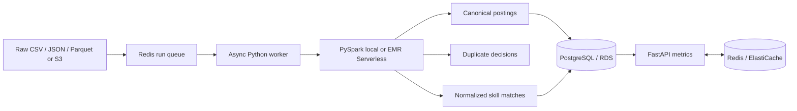

# Distributed Skill Analytics Engine & REST API

A production-style backend for ingesting unstructured job postings, deduplicating reposts with
PySpark, extracting normalized technology skills, publishing query-ready records to PostgreSQL, and
serving filterable analytics through FastAPI with Redis cache-aside acceleration.

The repository retains the original notebook study for provenance, but the supported runtime is the
containerized service under `src/skill_analytics`.

## Current implementation

- Asynchronous FastAPI service with health, processing-run, and skill-demand endpoints.
- Redis-backed durable run queue and cache-aside metrics responses.
- PostgreSQL normalized schema with source/business-key uniqueness and composite filter indexes.
- PySpark canonicalization, source-redelivery handling, repost classification, skill extraction, and
  before/after partition-skew metrics.
- Deterministic publisher from Spark outputs into PostgreSQL, followed by Redis invalidation.
- Local Docker Compose stack for the API, worker, PostgreSQL, and Redis.
- AWS adapter for ECS workers to submit PySpark jobs to EMR Serverless, with RDS, ElastiCache, and S3
  as the production service mapping.
- Unit, Spark, and PostgreSQL/Redis integration tests in GitHub Actions.
- Repeatable Spark and API benchmark scripts that produce dated JSON evidence.

## Architecture



The deduplication contract distinguishes source redelivery from a repost. Repost candidates are
grouped by a high-cardinality SHA-256 key derived from normalized company, title, and location, then
compared within a bounded time window. Optimized runs repartition by that key and record partition
row counts and skew ratios before and after the transformation.

## Quick start

Requirements: Docker Desktop with Compose.

```bash
cp .env.example .env
docker compose up --build -d
curl http://localhost:8000/health
```

Submit the checked-in cleaned artifact to the asynchronous worker:

```bash
curl -X POST http://localhost:8000/v1/runs \
  -H 'Content-Type: application/json' \
  -d '{
    "input_uri": "/data/legacy/processed/jobs_cleaned.csv",
    "output_uri": "/data/output/legacy-baseline",
    "optimized": true
  }'
```

The response contains a run UUID. Poll it with:

```bash
curl http://localhost:8000/v1/runs/RUN_ID
```

## REST API

Interactive OpenAPI documentation is available at `http://localhost:8000/docs`.

| Method | Path | Purpose |
|---|---|---|
| `GET` | `/health` | PostgreSQL and Redis readiness |
| `POST` | `/v1/runs` | Queue a Spark processing run |
| `GET` | `/v1/runs/{run_id}` | Inspect status, counts, duration, and evidence |
| `GET` | `/v1/metrics/skill-demand` | Aggregate posting counts by skill, role, and location |

The metrics endpoint accepts `skill`, `role_family`, `location`, `start_date`, and `end_date` query
parameters. Responses include `X-Cache: hit|miss` and `Server-Timing`; Redis keys are stable hashes of
canonicalized filters and are invalidated after successful publication.

Example:

```bash
curl 'http://localhost:8000/v1/metrics/skill-demand?skill=python&role_family=data%20engineer&location=nyc'
```

## Skill taxonomy

`config/skill_taxonomy.csv` is a starter taxonomy used for development. Production runs should set
`MINIMUM_CANONICAL_SKILLS=500`; the pipeline fails closed when the taxonomy contains fewer distinct
canonical skills than the configured threshold. Aliases do not count as canonical skills.

A 500+ claim requires a versioned, reviewed taxonomy and a dated processing manifest proving the
number of distinct canonical skills actually matched in the retained dataset.

## Performance evidence

Run baseline and repartitioned Spark jobs against the same immutable input:

```bash
python benchmarks/run_spark_benchmark.py \
  --input-uri data/input/jobs.parquet \
  --taxonomy-path config/skill_taxonomy.csv \
  --output-root evidence/spark \
  --master 'local[*]' \
  --partitions 8 \
  --repeats 5
```

Measure the warm Redis cache path:

```bash
python benchmarks/run_api_benchmark.py \
  --url 'http://localhost:8000/v1/metrics/skill-demand?skill=python&location=nyc' \
  --requests 100 \
  --output evidence/api_benchmark.json
```

The scripts record raw timings, medians/p95, configuration, and whether the stated target was met.
They do not manufacture a 40-to-12-minute or sub-50ms result.

The latest local validation processed the checked-in 4,137-row fixture end to end and measured a
1.989 ms warm-cache p95 over 100 populated, multi-attribute requests. This proves the implementation
path, not the proposed 120,000-row production-scale claim. See `docs/LOCAL_VALIDATION.md`.

## Resume-claim gates

| Proposed result | Required evidence | Current status |
|---|---|---|
| 120,000+ postings | Immutable input manifest and reconciled input/output counts | Not yet measured; local fixture has 4,137 rows |
| 18% repost removal | Persisted duplicate decisions with an explicit denominator | Not supported by local fixture: 2 of 4,137 rows |
| 500+ skills | Versioned taxonomy plus distinct matched canonical-skill count | Not yet supported; local run matched 65 canonical skills |
| 40 to 12 minutes | Five or more same-input baseline/optimized runs and Spark partition profiles | Not yet measured; one optimized local run took 17.6 seconds |
| Sub-50ms filters | Warm-cache p95 from the API benchmark against a populated database | Locally met: 1.989 ms p95, 100/100 cache hits, 4,135 postings |

Use the measured values when they differ from the proposed resume language.

## AWS production mapping

Set `EXECUTION_BACKEND=emr-serverless` on the worker to submit processing jobs through the AWS SDK.
The intended production topology is:

- API and worker images in ECR, running on ECS Fargate.
- PostgreSQL on private RDS and Redis on private ElastiCache.
- Raw, curated, log, and benchmark prefixes in S3.
- PySpark on EMR Serverless.
- Secrets Manager for runtime secrets and CloudWatch for service/job logs.

See `infra/aws/README.md` and the scoped worker IAM policy template. Cloud execution requires a real
AWS account, provisioned resources, and an S3-packaged Spark entry point.

## Development

```bash
python -m venv .venv
source .venv/bin/activate
make install
make lint
make test
```

Run integration tests while PostgreSQL and Redis are available:

```bash
docker compose up -d postgres redis
make test-integration
```

## Repository map

```text
src/skill_analytics/       FastAPI, queue worker, publisher, Spark, and AWS adapters
config/                    Versioned skill taxonomy
db/migrations/             PostgreSQL schema and composite indexes
docker/                    API and worker images
benchmarks/                Spark and API measurement harnesses
infra/aws/                 AWS topology and IAM contract
tests/                     Unit, Spark, and service integration tests
notebooks/                 Legacy acquisition and analysis notebooks
docs/                      Upgrade plan and supporting design documentation
```

## Legacy data warning

The checked-in legacy artifact contains 4,137 cleaned rows: 3,608 Adzuna and 529 Hacker News. Its
material dates are May 2024, October 2024, and October 2025, so it cannot support a continuous
longitudinal claim. It is useful as a migration fixture, not as evidence for the proposed scale and
performance results.
