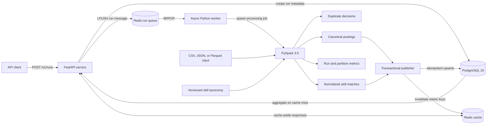
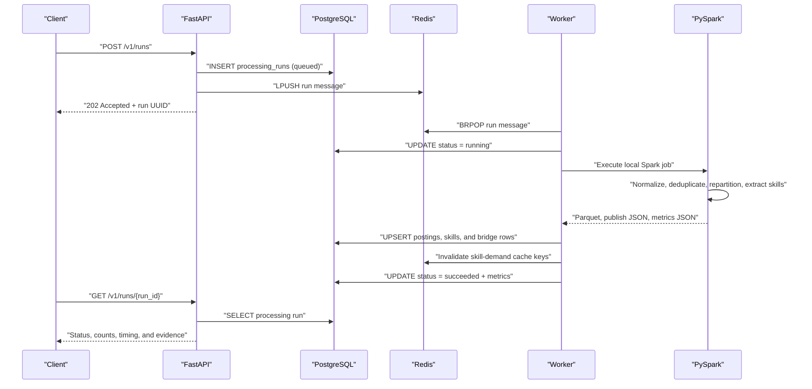
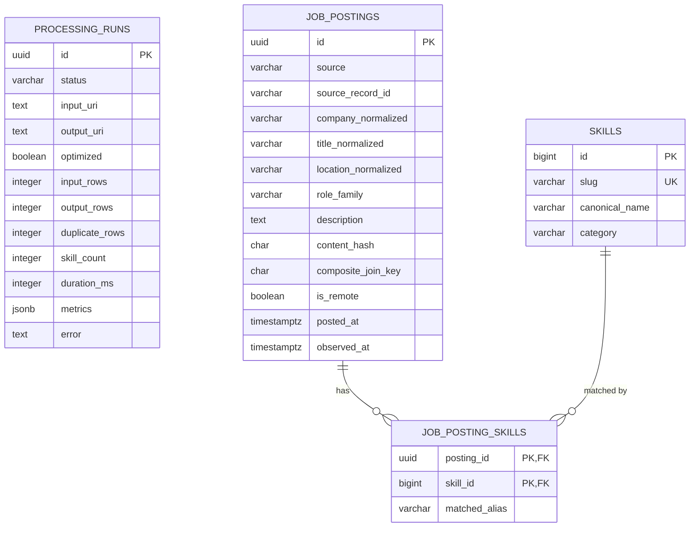
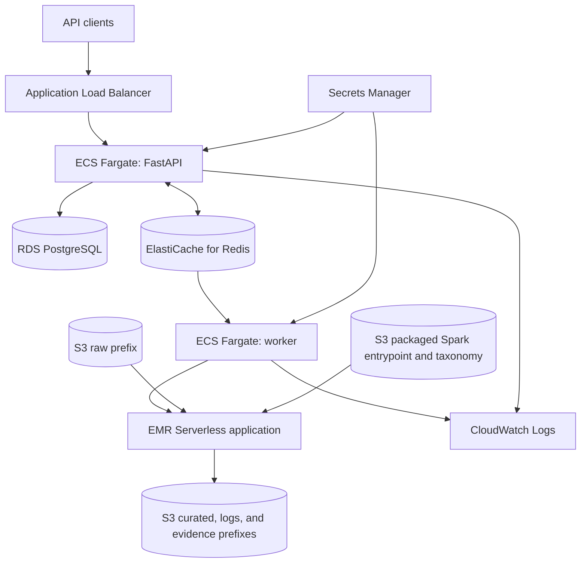

# Distributed Skill Analytics Engine & REST API

An asynchronous backend that turns unstructured job postings into queryable skill-demand metrics.
The supported runtime uses Python, FastAPI, PySpark, PostgreSQL, Redis, Docker, and an AWS EMR
Serverless execution adapter. The original notebooks and Streamlit dashboard remain in the
repository as the legacy analysis surface and migration fixture.

<p align="center">
  
  
  
  
  
  
  
</p>

<p align="center">
  <a href="https://job-market-analytics-fx.streamlit.app/"><strong>Legacy Streamlit dashboard</strong></a>
  ·
  <a href="https://daniel21b.github.io/Job-Market-Analytics/"><strong>Legacy analysis report</strong></a>
  ·
  <a href="docs/LOCAL_VALIDATION.md"><strong>Validation record</strong></a>
</p>

## What is implemented

- Asynchronous FastAPI endpoints for service health, processing-run submission, run status, and
  multi-attribute skill-demand aggregation.
- Redis list-backed worker queue plus a cache-aside layer with canonical filter hashing, TTLs, and
  post-publication invalidation.
- PySpark canonicalization, pandas-compatible multiline CSV parsing, source-redelivery removal,
  exact and near-repost classification, partition-skew measurement, composite-key repartitioning,
  and normalized skill extraction.
- PostgreSQL run metadata, canonical postings, skills, and posting-to-skill relationships with
  idempotent upserts and composite indexes for the API filter pattern.
- Separate non-root API and Java 17/PySpark worker images, with PostgreSQL and Redis wired through
  Docker Compose health checks.
- An AWS SDK adapter that submits and monitors EMR Serverless Spark jobs, plus an ECS/RDS/
  ElastiCache/S3 deployment contract and scoped IAM policy template.
- GitHub Actions checks for lint, unit tests, PostgreSQL/Redis integration, Spark behavior, and both
  Docker image builds.
- Repeatable Spark and API benchmark harnesses that write dated JSON evidence rather than embedding
  unverified resume metrics.

## Architecture

### Implemented local execution path



The API and worker are deliberately separated. API requests stay lightweight while the worker owns
the blocking Spark lifecycle. The processing run in PostgreSQL is the durable status record; Redis
contains the queue message and cached query responses.

### Processing lifecycle



If Spark or publication fails, the worker records a terminal `failed` state and a bounded,
parameter-hidden error in `processing_runs`. Automatic retry and dead-letter handling are not yet
implemented; a new run must currently be submitted after the underlying cause is corrected.

### Spark transformation stages

| Stage | Input | Operation | Output |
|---|---|---|---|
| Read | CSV, JSON, or Parquet | Multiline/double-quote-safe ingestion and row reconciliation | Raw Spark DataFrame |
| Canonicalize | Source-specific columns | Normalize company, title, location, role, timestamps, source ID, and remote flag | Canonical schema |
| Source delivery filter | `(source, source_record_id)` | Retain the latest observation; label earlier deliveries | `source_redelivery` decisions |
| Repartition | Canonical postings | Hash normalized company, title, and location into a high-cardinality join key | Balanced Spark partitions |
| Repost comparison | Keyed postings | Compare adjacent postings with content hashes, bounded dates, and Levenshtein similarity | Exact/near repost decisions |
| Skill extraction | Canonical descriptions + taxonomy | Tokenize, generate 1–4-grams, broadcast the taxonomy, and join on normalized aliases | Posting-to-skill matches |
| Evidence | Before/after DataFrames | Count rows, matches, distinct skills, partition sizes, skew ratios, and duration | `pipeline_metrics.json` |
| Publish | Canonical and match outputs | Write Parquet artifacts and compact JSON records for PostgreSQL publication | Curated output tree |

The optimized path repartitions on `composite_join_key` before the window comparison. Every run
captures both pre- and post-transformation partition profiles so performance claims can be tied to
the same immutable input and configuration.

### PostgreSQL data model



The publisher derives deterministic posting UUIDs and uses PostgreSQL `ON CONFLICT` upserts, making
republication of the same source record idempotent.

Key query and integrity indexes:

| Index or constraint | Columns | Purpose |
|---|---|---|
| `uq_job_posting_source_record` | `source, source_record_id` | Prevent duplicate source deliveries |
| `ix_job_postings_content_hash` | `content_hash` | Support exact-content investigation |
| `ix_job_postings_composite_key_posted` | `composite_join_key, posted_at` | Support repost history lookup |
| `ix_job_postings_filters` | `role_family, location_normalized, posted_at` | Match the API’s multi-filter access pattern |
| `ix_job_posting_skills_skill_posting` | `skill_id, posting_id` | Accelerate skill-to-posting aggregation |

### Redis responsibilities

Redis serves two independent namespaces:

1. `skill-analytics:runs` stores serialized run messages consumed by the worker with `BRPOP`.
2. `skill-analytics:metrics:skill-demand:<sha256>` stores cache-aside responses. The SHA-256 suffix
   is computed from sorted, canonical JSON filters so logically identical requests share a key.

Metrics use a configurable TTL and all skill-demand keys are invalidated only after the PostgreSQL
publication transaction commits.

### Docker service topology

| Service | Image/runtime | Responsibility | Dependency |
|---|---|---|---|
| `api` | Python 3.11 slim, non-root | FastAPI REST service on port 8000 | Healthy PostgreSQL and Redis |
| `worker` | Python 3.11 + Java 17 + PySpark, non-root | Queue consumer, Spark execution, publication | Healthy API, PostgreSQL, and Redis |
| `postgres` | PostgreSQL 16 Alpine | Durable run and analytics store | Migration mounted at initialization |
| `redis` | Redis 7 Alpine with AOF | Run queue and response cache | Persistent Docker volume |

The `.dockerignore` excludes the legacy notebooks, data, virtual environment, tests, and Git history
from production build contexts. Java is linked through an architecture-neutral path, so the worker
image builds on AMD64 and ARM64.

### AWS deployment target



The checked-in AWS adapter implements EMR Serverless submission and terminal-state polling. The
repository also provides the task-role IAM contract and required configuration. Provisioning ECS,
RDS, ElastiCache, S3, networking, Secrets Manager, and the downstream S3-to-PostgreSQL publication
step remains an environment-specific deployment task; no cloud resources are created by this repo.

See [`infra/aws/README.md`](infra/aws/README.md) and
[`infra/aws/emr-worker-policy.json`](infra/aws/emr-worker-policy.json).

## REST API

Interactive OpenAPI documentation is available at `http://localhost:8000/docs`.

| Method | Path | Purpose |
|---|---|---|
| `GET` | `/health` | Verify PostgreSQL and Redis readiness |
| `POST` | `/v1/runs` | Persist and enqueue a Spark processing run |
| `GET` | `/v1/runs/{run_id}` | Return status, counts, duration, metrics, and failure details |
| `GET` | `/v1/metrics/skill-demand` | Aggregate posting counts by skill, role, location, and date range |

The metrics endpoint accepts `skill`, `role_family`, `location`, `start_date`, and `end_date`.
Responses include `X-Cache: hit|miss` and `Server-Timing` headers.

```bash
curl 'http://localhost:8000/v1/metrics/skill-demand?skill=python&role_family=uncategorized&location=seattle%20wa'
```

## Quick start

Requirements: Docker with the Compose plugin.

```bash
cp .env.example .env
docker compose up --build -d
curl http://localhost:8000/health
```

Submit the checked-in migration fixture:

```bash
curl -X POST http://localhost:8000/v1/runs \
  -H 'Content-Type: application/json' \
  -d '{
    "input_uri": "/data/legacy/processed/jobs_cleaned.csv",
    "output_uri": "/data/output/legacy-baseline",
    "optimized": true
  }'
```

Poll the returned UUID:

```bash
curl http://localhost:8000/v1/runs/RUN_ID
```

Stop the stack without deleting its named volumes:

```bash
docker compose down
```

## Configuration

Configuration is loaded from environment variables or `.env` through `pydantic-settings`.

| Area | Important variables |
|---|---|
| Service | `APP_ENV`, `LOG_LEVEL`, `AUTO_CREATE_SCHEMA` |
| PostgreSQL | `DATABASE_URL` |
| Redis | `REDIS_URL`, `QUEUE_NAME`, `CACHE_TTL_SECONDS` |
| Spark | `SPARK_MASTER_URL`, `SPARK_PARTITIONS`, `SPARK_INPUT_URI`, `SPARK_OUTPUT_URI` |
| Taxonomy | `SKILL_TAXONOMY_PATH`, `MINIMUM_CANONICAL_SKILLS` |
| Execution | `EXECUTION_BACKEND=local` or `emr-serverless` |
| AWS | `AWS_REGION`, EMR application/role/entrypoint/log URIs, and S3 bucket settings |

Production runs should set `MINIMUM_CANONICAL_SKILLS=500`. The pipeline fails closed when the
taxonomy has fewer distinct canonical skills than the configured minimum. The development taxonomy
is intentionally smaller and cannot substantiate a 500+ matched-skill claim.

## Development and verification

```bash
python -m venv .venv
source .venv/bin/activate
make install
make lint
make test
```

With PostgreSQL and Redis running:

```bash
make test-integration
```

Benchmark baseline and repartitioned Spark runs against the same immutable input:

```bash
python benchmarks/run_spark_benchmark.py \
  --input-uri data/input/jobs.parquet \
  --taxonomy-path config/skill_taxonomy.csv \
  --output-root evidence/spark \
  --master 'local[*]' \
  --partitions 8 \
  --repeats 5
```

Measure the populated warm-cache path:

```bash
python benchmarks/run_api_benchmark.py \
  --url 'http://localhost:8000/v1/metrics/skill-demand?skill=python&location=seattle%20wa' \
  --requests 100 \
  --output evidence/api_benchmark.json
```

## October 2026 real-posting benchmark

The expanded actual pipeline run processed **200,000 real postings**, retained **174,361** canonical records, flagged **25,639 heuristic duplicate candidates (12.82%)**, and produced **66,339 matches across 73 skills**. Python-skill HTTP requests measured **0.833 ms warm-cache p95** (1,000 sequential requests) and **11.309 ms cache-miss p95** (100 requests) locally. Unfiltered cache misses measured **52.090 ms p95**; a blanket sub-50 ms guarantee is not supported.

[Read the expanded benchmark and reproduction instructions](docs/BENCHMARK_2026-10-26.md). The [original 120,000-record run](docs/BENCHMARK_2026-10-25.md) is preserved. These overlapping samples contain 200,000 unique source IDs in total, not 320,000. Original project dates and October follow-up measurements remain separate.

## Historical fixture result

The earlier local end-to-end run used the checked-in migration fixture:

| Metric | Result |
|---|---:|
| Input rows | 4,137 |
| Canonical postings | 4,135 |
| Duplicate decisions | 2 |
| Matched canonical skills | 65 |
| Skill-match rows | 2,164 |
| Optimized local duration | 17.627 seconds |
| Partition skew ratio | 1.644 → 1.060 |
| Populated cache benchmark | 0.898 ms p50, 1.989 ms p95, 100/100 hits |

Full environment and measurement details are recorded in
[`docs/LOCAL_VALIDATION.md`](docs/LOCAL_VALIDATION.md).

## Resume-claim evidence gates

| Proposed result | Required evidence | Current status |
|---|---|---|
| 120,000+ postings | Immutable input manifest and reconciled input/output counts | Measured 200,000 real input records in October 2026 |
| 18% repost removal | Persisted duplicate decisions with an explicit denominator | Not supported: 25,639 of 200,000 candidates (12.82%) |
| 500+ skills | Versioned taxonomy and distinct matched canonical-skill count | Not supported: 73 matched skills |
| 40 to 12 minutes | Five or more same-input baseline/optimized runs | Not measured; October Spark run took 1,130.362 seconds |
| Sub-50 ms filters | Warm-cache p95 against populated tables | Met locally for Python skill: 0.833 ms p95 over 1,000 cache hits |

Use measured values when they differ from proposed resume language.

## Repository structure

```text
Job-Market-Analytics/
├── src/skill_analytics/
│   ├── api/
│   │   ├── dependencies.py       # Database, Redis, cache, and settings injection
│   │   └── routes/               # Health, run lifecycle, and metrics endpoints
│   ├── aws/
│   │   └── emr_serverless.py     # EMR Serverless submit-and-poll adapter
│   ├── spark/
│   │   ├── job.py                # Spark session, I/O, artifacts, and run metrics
│   │   ├── pipeline.py           # Canonicalization, deduplication, skew, and skills
│   │   ├── normalization.py      # Deterministic text and composite-key helpers
│   │   └── taxonomy.py           # Taxonomy loading and validation
│   ├── cache.py                  # Redis cache keys, TTL, and invalidation
│   ├── config.py                 # Typed environment configuration
│   ├── database.py               # Async SQLAlchemy engine and sessions
│   ├── main.py                   # FastAPI application lifecycle
│   ├── models.py                 # PostgreSQL ORM schema and indexes
│   ├── publisher.py              # Spark-output-to-PostgreSQL upserts
│   ├── repository.py             # Processing-run and skill-demand queries
│   ├── schemas.py                # API request and response contracts
│   ├── services.py               # Queue and cache-aside orchestration
│   └── worker.py                 # Redis consumer and execution backend selection
├── config/skill_taxonomy.csv     # Versioned canonical skills and aliases
├── db/migrations/                # PostgreSQL DDL and composite indexes
├── docker/                       # API and Java 17/PySpark worker images
├── benchmarks/                   # Repeatable Spark and API evidence harnesses
├── infra/aws/                    # AWS deployment contract and worker IAM policy
├── tests/unit/                   # Fast unit and Spark behavior tests
├── tests/integration/            # PostgreSQL/Redis service-stack test
├── notebooks/                    # Legacy acquisition and analysis workflow
├── docs/                         # Architecture plan and local validation record
├── docker-compose.yml            # Local four-service topology
├── pyproject.toml                # Package, dependency, lint, and test configuration
└── .github/workflows/ci.yml      # GitHub Actions quality gates
```

## Legacy data and security notes

The checked-in fixture contains 4,137 cleaned rows: 3,608 Adzuna and 529 Hacker News. Its material
dates are May 2024, October 2024, and October 2025, so it is a useful migration fixture—not evidence
of continuous eight-month history or production scale.

The current notebook reads Adzuna credentials from `ADZUNA_APP_ID` and `ADZUNA_API_KEY`. A credential
that appeared in earlier Git history should still be revoked and replaced; this upgrade does not
rewrite published history.
