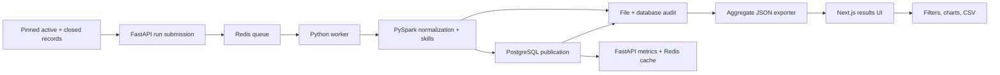

# 500,000-record benchmark and web results dashboard — October 29, 2026

This October follow-up processes 500,000 unique real source posting IDs, including the prior 200,000-record sample plus 300,000 additional IDs. Overlapping runs are not summed. Original project development was January–March 2025; these measurements belong to October 2026.

## Input and provenance

[OpenJobData / Jobs-Dataset-v2](https://huggingface.co/datasets/scholarweave/Jobs-Dataset-v2), pinned revision `7675a78a63ea3d42d47515a350ac7650da972bd0`. Provider snapshot: 2026-10-25T16:29:33.600029+00:00. Frozen sample: 2026-10-28T16:38:50.597283+00:00.

Selected 442,966 active-snapshot records and 57,034 archived closed records; 112,492 source-dated 2025 and 387,508 source-dated 2026. These are not 500,000 currently open vacancies.

Active shards in numeric order, then closed archive in reverse path order when enabled; original row order; stop at target. Convenience sample, not representative.

United States; nonempty title/company/source ID; description >=200 characters; source posted date 2025-01-01 through snapshot timestamp; unique source posting IDs.

Stable source company IDs used as company identity; SHA256 of posting ID as source_record_id; location is country only because minimal source lacks consistent city/region. Original posting ID and source URL retained in frozen input.

Examined 2,135,276 source rows; repeated IDs are excluded across active and closed sources. Archived string timestamps are parsed as ISO dates; timezone-less values are treated as UTC. Provider dates are not independently verified. This convenience sample is not representative of all hiring activity.

SHA-256: `e4d715afe69232f33454888abc37b74e7fd3a3a31d57a786656f2f263ce162b1`. [Sample and source-file hashes](../evidence/2026-10-29/sample-manifest.json), [closed archive manifest](../evidence/2026-10-29/closed-source-manifest.json), and [independent input audit](../evidence/2026-10-29/independent-input-audit.json). Raw descriptions stay local; only aggregates and provenance are published. The dataset card labels the dataset Apache-2.0; underlying descriptions may retain source rights.

## Audit correction

The first completed 500,000-record attempt was rejected: timestamp ties led to 2,188 IDs appearing in both output branches and 2,193 input IDs in neither. It is not counted as a successful benchmark. The corrected pipeline orders ties by posting key, shares comparison results, checks the count invariant before publication, and verifies output ID sets are disjoint. A reversed-input/repartition regression test passes. [Rejected-run audit](../evidence/2026-10-29/rejected-run-audit.json).

## Completed processing

| Metric | Observed |
|---|---:|
| Input records | 500,000 |
| Retained canonical postings | 411,135 |
| Duplicate candidates | 88,865 |
| Skill-match relationships | 156,491 |
| Distinct matched skills | 73 |
| Spark phase, milliseconds | 585,748 |

Duplicate candidate rate: 17.773%. Reasons: exact_repost: 53,763, near_repost: 35,102. These are heuristic decisions, not audited duplicate precision. Country-only locations can conflate distinct openings. Skill aliases can be ambiguous (e.g. “go”); matching is not evidence of proficiency or an audited requirement.

The actual API → Redis queue → worker → Spark → PostgreSQL publisher path completed. [Run timestamps and metrics](../evidence/2026-10-29/run-completed.json) and [independent file/database reconciliation](../evidence/2026-10-29/output-audit.json) substantiate the result. Spark timing excludes PostgreSQL publication. Earlier interrupted attempts and the rejected run are excluded from successful results.

## Duplicate comparison change

Pipeline commit: `be5c3d7e7f59269316b8b03664d7ed7ffc8aab68`. Exact hashes bypass edit distance; near-repost comparisons only run inside the existing 90-day window. Threshold-bounded Levenshtein stops when a pair cannot reach 0.92 similarity. The edit budget rounds up and the original similarity predicate makes the final decision. Boundary tests compare decisions with unbounded distance, including exact matches outside the time window and pairs immediately above/below the threshold.

This is not a controlled speedup study: sample composition, CPU parallelism and heap differ from the earlier run. No 40-to-12-minute claim is made.

## Local HTTP results

| Query | Cache mode | Requests | p50 ms | p95 ms | p99 ms |
|---|---|---:|---:|---:|---:|
| all skills | cold_cache | 100 | 146.095 | 149.667 | 150.426 |
| all skills | warm_cache | 1000 | 0.632 | 0.766 | 1.482 |
| {'skill': 'python'} | cold_cache | 100 | 18.373 | 19.516 | 20.563 |
| {'skill': 'python'} | warm_cache | 1000 | 0.574 | 0.738 | 1.409 |
| {'skill': 'sql', 'location': 'united states'} | cold_cache | 100 | 9.656 | 12.483 | 16.579 |
| {'skill': 'sql', 'location': 'united states'} | warm_cache | 1000 | 0.571 | 0.667 | 1.02 |

Sequential HTTP requests, concurrency 1, persistent httpx connection; nearest-rank percentiles. Cold cache deletes only the exact query key before each request; PostgreSQL/OS caches are not reset. Warm cache primed once. Connection setup and deletion excluded from timings. No empty-result queries.

[Raw request timings and hit/miss counts](../evidence/2026-10-29/api-latency.json). Loopback HTTP, concurrency one. Redis misses do not reset PostgreSQL/OS caches. These are local observations, not a production SLA or a blanket sub-50 ms guarantee.

## Results frontend

[Job Market Observatory](https://danielberhane.vercel.app/en/analytics) replaces the Streamlit results dashboard with Next.js, React and TypeScript. The [frontend source](https://github.com/Daniel21b/Portfolio/tree/main/src/components/analytics-dashboard) renders an audited aggregate JSON snapshot. Controls filter skill/month/category, toggle chart/table views and export aggregates. It does not call the local processing API, expose database credentials, or present the snapshot as live vacancies.



The exported monthly totals reconcile with retained postings and skill relationships. Skills overlap across postings; summing skill counts does not count distinct jobs. No city, salary or role-family breakdown is invented. Ambiguous aliases and biased sampling limit interpretation.

## Reproduction and validation

Environment: Python 3.11.11, PySpark 3.5.9, Corretto Java 11, ARM64 macOS, 10 CPU cores / 24 GiB RAM. Spark `local[6]`, 8 partitions, 6 GiB driver heap. Local PostgreSQL 15 and Redis 7.2.7, isolated database and Redis namespace. [Execution settings](../evidence/2026-10-29/execution-environment.json) and [Python environment](../evidence/2026-10-29/python-environment.txt).

Install `pip install -e ".[spark,dev]" pandas pyarrow`. Set `JAVA_HOME`, `PYSPARK_PYTHON`, `SPARK_MASTER_URL=local[6]`, `SPARK_PARTITIONS=8`, and `PYSPARK_SUBMIT_ARGS="--driver-memory 6g pyspark-shell"`. Start the API and worker against empty isolated services as described in the README.

```sh
python benchmarks/freeze_openjobdata.py --evidence evidence/2026-10-29 --data-dir /tmp/job-data --target 500000 --include-closed
# POST /v1/runs with /tmp/job-data/postings-500000.parquet and a new output directory.
# Wait for succeeded; save the result as run-completed.json in your evidence directory.
python benchmarks/audit_frozen_output.py --evidence evidence/2026-10-29 --output-dir /tmp/job-output --database-url "$AUDIT_DATABASE_URL"
python benchmarks/measure_frozen_api.py --base-url http://127.0.0.1:8042 --redis-url redis://127.0.0.1:6398/5 --output /tmp/api-latency.json
python benchmarks/export_dashboard_snapshot.py --evidence evidence/2026-10-29 --output-dir /tmp/job-output --destination /path/to/Portfolio/src/data/analytics-snapshot.json
```

Keep manifests pinned when reproducing. Changing PyArrow versions may change Parquet bytes even when selected records are equivalent. Unit/Spark tests, service integration tests, output reconciliation, API measurements and frontend checks are recorded with the change.

Validation: 14 unit/Spark tests and one PostgreSQL/Redis integration test passed; lint and GitHub CI (including both container builds) passed. The frontend passed production build, TypeScript and targeted browser checks.
